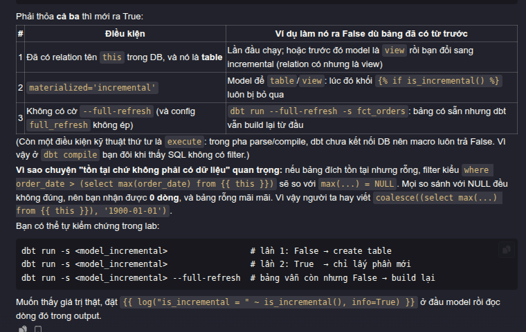

# 2.1 Incremental models: append, merge, delete+insert

## Khái niệm

Model `table` mỗi lần chạy **xây lại toàn bộ**. Model `incremental` lần đầu xây toàn bộ, những lần sau **chỉ xử lý dữ liệu mới/thay đổi** rồi ghép vào bảng đã có.

```
Lần 1 (hoặc --full-refresh):  create table fct_x as select ... (toàn bộ)
Lần 2+ :                      select ... where <chỉ dữ liệu mới>  ──[chiến lược]──▶ ghép vào fct_x
```

Dùng khi: bảng lớn, build `table` quá lâu/tốn tiền, dữ liệu chủ yếu là sự kiện thêm mới.
Không dùng khi: bảng nhỏ (dưới vài triệu dòng thường chưa cần) — incremental thêm độ phức tạp và rủi ro sai.

## Cấu trúc cơ bản

```sql
-- models/marts/sales/fct_sales.sql
{{ config(
    materialized='incremental',
    unique_key='sales_key',
    incremental_strategy='merge',
    on_schema_change='append_new_columns'
) }}

select
    {{ dbt_utils.generate_surrogate_key(['order_id', 'order_line_id']) }} as sales_key,
    order_id,
    order_line_id,
    order_date,
    line_total_amount,
    modified_at
from {{ ref('int_orders__joined_details') }}


where modified_at > (select max(modified_at) from {{ this }})

```

| Thành phần | Ý nghĩa |
|---|---|
| `is_incremental()` | `True` khi: bảng đích đã tồn tại **và** model là incremental **và** không chạy `--full-refresh` |
| `{{ this }}` | Bảng đích hiện tại (chính model này trong warehouse) |
| `unique_key` | Cột (hoặc list cột) xác định 1 dòng, dùng để update/xoá bản cũ |
| `on_schema_change` | Khi model thêm/bớt cột: `ignore` (mặc định), `fail`, `append_new_columns`, `sync_all_columns` |

## 3 chiến lược chính

### 1. `append`

Chỉ `insert` dòng mới, **không** kiểm tra trùng.

```sql
insert into fct_x select ... from <batch mới>
```

- ✅ Nhanh nhất, rẻ nhất.
- ❌ Chạy lại cùng batch → dữ liệu trùng. Không xử lý được bản ghi bị update.
- Dùng cho: log/event bất biến (clickstream, audit log), nơi mỗi sự kiện chỉ đến 1 lần.

### 2. `merge`

Dùng câu `MERGE`: khớp theo `unique_key` → có thì `update`, chưa có thì `insert`.

```sql
merge into fct_x as t
using <batch mới> as s
on t.sales_key = s.sales_key
when matched then update set ...
when not matched then insert ...
```

- ✅ Idempotent (chạy lại không trùng), xử lý được update.
- ❌ Phải quét bảng đích để khớp khoá → chậm/tốn khi bảng rất lớn (giảm bằng `incremental_predicates` để giới hạn vùng quét).
- Dùng cho: bảng có bản ghi bị sửa (đơn hàng đổi trạng thái), là mặc định trên Snowflake/BigQuery.
- Có thể giới hạn cột được update bằng `merge_update_columns` hoặc `merge_exclude_columns`.

### 3. `delete+insert`

Xoá các dòng trong bảng đích có khoá trùng với batch mới, rồi insert batch.

```sql
delete from fct_x where sales_key in (select sales_key from <batch mới>);
insert into fct_x select ... from <batch mới>;
```

- ✅ Idempotent; trên một số warehouse nhanh hơn merge khi thay cả cụm dữ liệu (vd thay cả ngày).
- ✅ Hữu ích khi `unique_key` là khoá **không thật sự duy nhất ở mức dòng**, ví dụ `unique_key='order_date'` → thay toàn bộ dữ liệu của những ngày đó.
- ❌ 2 câu lệnh; nếu warehouse không chạy trong transaction an toàn thì có thể có khoảnh khắc thiếu dữ liệu.
- Dùng cho: tính lại theo partition ngày, warehouse không hỗ trợ `MERGE` tốt (vd Postgres bản cũ).

### So sánh nhanh

| | append | merge | delete+insert |
|---|---|---|---|
| Cần `unique_key` | Không | Có | Có |
| Xử lý update | ❌ | ✅ theo dòng | ✅ theo nhóm khoá |
| Chạy lại an toàn | ❌ | ✅ | ✅ |
| Chi phí | Thấp nhất | Cao khi bảng lớn | Trung bình |

### Các chiến lược khác (biết tên)

- `insert_overwrite`: ghi đè **cả partition** (BigQuery, Spark). Sẽ gặp ở project BigQuery tuần 5.
- `microbatch` (dbt ≥ 1.9): dbt tự chia thời gian thành batch theo `event_time`, mỗi batch chạy độc lập, retry được từng batch, hỗ trợ `lookback` và backfill theo khoảng ngày. Xem thêm ở 2.2.

Mỗi adapter hỗ trợ tập chiến lược khác nhau → kiểm tra trang docs của adapter bạn dùng.

## Lỗi hay gặp

- `unique_key` không thật sự duy nhất trong batch với `merge` → lỗi "duplicate row" hoặc kết quả sai. Phải dedupe batch trước.
- Filter dùng `>=` hay `>` sai → mất hoặc lặp dữ liệu ở biên.
- So sánh `max(modified_at)` khi bảng đích rỗng → `null`, filter loại hết. Dùng `coalesce(max(...), '1900-01-01')`.
- Thêm cột mới mà `on_schema_change='ignore'` → cột mới không bao giờ xuất hiện.
- Không bao giờ test `--full-refresh` → đến lúc cần rebuild mới phát hiện logic lần đầu sai.
- Dùng `append` cho dữ liệu có update.

## Áp dụng vào adventure_works

AdventureWorks có cột `ModifiedDate` ở hầu hết bảng → dùng làm watermark.

- [ ] `append`: một bảng log giả lập (vd `fct_order_events` sinh từ thay đổi trạng thái)
- [ ] `merge`: `fct_sales` với `unique_key` là surrogate key
- [ ] `delete+insert`: `fct_daily_sales` với `unique_key='order_date'` (tính lại cả ngày)
- [ ] Kiểm chứng: chạy 2 lần liên tiếp, số dòng không đổi (idempotent) với merge/delete+insert
- [ ] Kiểm chứng: so sánh kết quả incremental với `--full-refresh` (dùng `dbt_utils.equal_rowcount` hoặc `audit_helper`)
- [ ] README: bảng "model – chiến lược – lý do chọn"

## Câu hỏi tự kiểm tra

1. Ba điều kiện nào làm `is_incremental()` trả `True`?
3 điều kiện là 
```

  {{ return(False) }}
  
  {{ return(
       relation is not none                              -- (1) bảng đích đã tồn tại
       and relation.type == 'table'                       --     và là TABLE (không phải view)
       and model.config.materialized == 'incremental'     -- (2) model đang cấu hình incremental
       and not should_full_refresh()                      -- (3) không chạy --full-refresh
  ) }}





```

2. Vì sao `append` không idempotent?
3. Khi nào chọn `delete+insert` thay `merge`?
4. `on_schema_change` có những giá trị nào, mặc định là gì?
5. Làm sao chứng minh model incremental cho ra cùng kết quả với full refresh?

## Tài liệu

- https://docs.getdbt.com/docs/build/incremental-models
- https://docs.getdbt.com/docs/build/incremental-strategy
- https://docs.getdbt.com/docs/build/incremental-microbatch
- Khoá dbt Learn: *Advanced Materializations*
